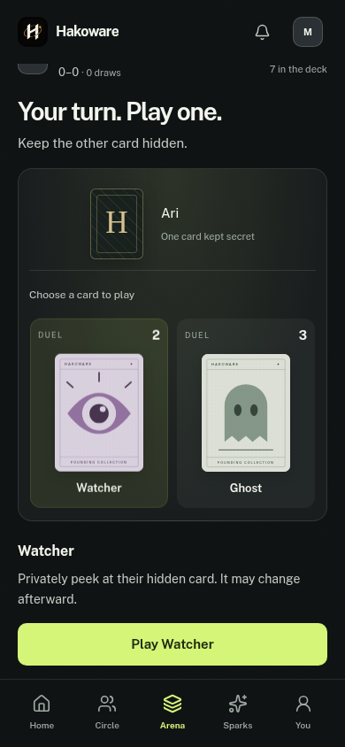
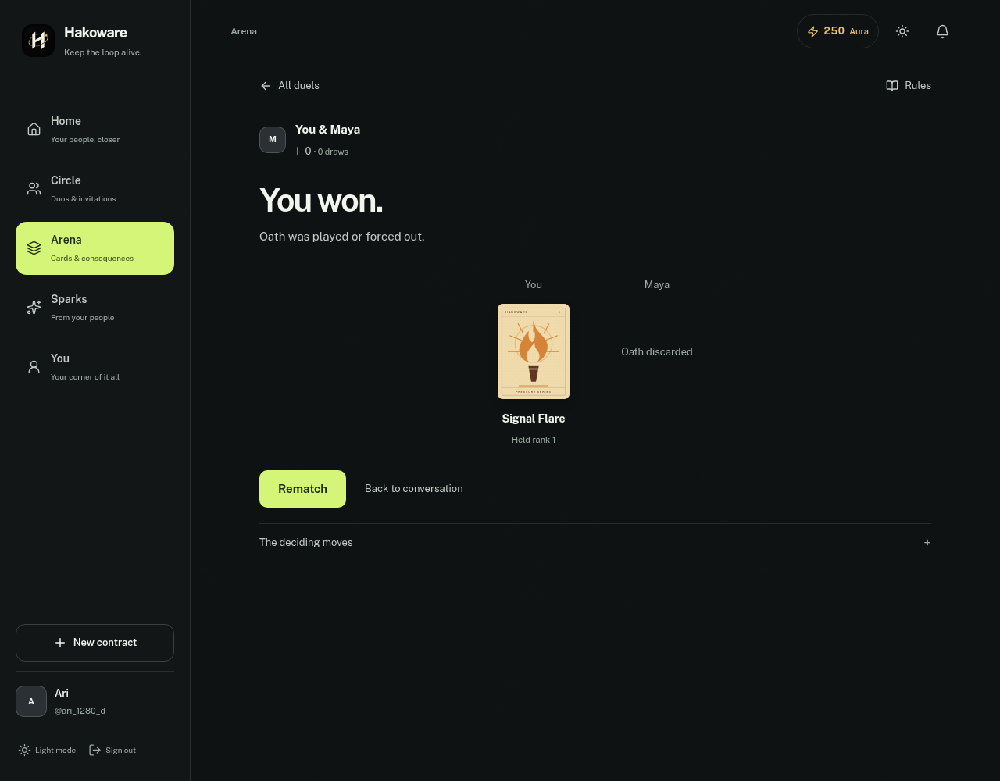

# Friend duels — October 14, 2026

Arena gains Duels beside Cards. An accepted friend's conversation also has an unboxed Card duel entry. Invitations require acceptance before the server deals; the invitee starts the first game and accepted rematches alternate the starter. The free twelve-card deck follows [the v1 rules](card-duel-v1.md). Owned cards are neither required nor consumed. Aura, loans, XP, debt, check-ins, purchases and paid cosmetic ownership are unchanged.

The focused table omits the surrounding Arena heading/tabs, shows the opponent's face-down card, your hand, actual turn/deck counts, Ghost protection and a dated private Watcher memory. Selecting a card reveals its effect and any guess/target choices. Oath explicitly says playing it loses. Mobile card names fit above the dock and selection brings the play controls into view. Completed rounds reveal final hands or the decisive Oath discard, update private rivalry scores, and offer a consent-based rematch or return to the exact conversation. Lobby rows remain unboxed. Rules/leave sheets support Escape and focus restoration; failures stay visible in the leave sheet.

Home offers a destination only for an incoming invitation or actual turn. Personal Activity links directly to the duel. Visible tables refresh every six seconds; the lobby/Home refresh every thirty seconds. Background tabs skip polling. No public announcement, email, web push, timer nag, wager or new reward system is added. Confirmed card plays reuse the existing quiet, opt-in sound cue.

## Persistence and privacy

One `DuelRoom` uses its friendship's built-in unique `_id`; no additional secondary index or replica-set transaction is needed. Current match, scores and history commit together through a revision comparison. Retry receipts prevent the same action from dealing/playing/scoring twice; distinct concurrent actions at one revision have a single winner. Client-supplied decks, hands and winners are ignored. Production shuffling uses cryptographic Fisher–Yates draws. History is capped at twenty completed rounds, receipts at sixty-four and the pending Activity queue at twenty-four entries.

Every read/write requires an authenticated participant in an accepted friendship and enforces live/test-owner isolation. Private state is excluded from ordinary model reads. Explicit response views expose only the caller's hand/Watcher memory and public moves; neither the deck nor the opponent's current hand is sent during play. Results reveal held cards only after completion. Abandoned/expired games award no win and expose no hidden hands. Idle invitations/rounds expire after seven days on access. Blocked or ended friendships are unavailable; Founder reset removes its scoped duel rooms.

Activity uses deterministic IDs and a durable queue, with superseded turns discarded on recovery. Acknowledging an old match/revision cannot clear a newer turn. Notification creation and queue cleanup are separate writes; this is not an exactly-once guarantee across every database/process failure. The normal retry, outage recovery and dismissed-notice cases are tested. Database writes still require actual free storage, despite avoiding the extra index-build requirement.

## Validation

- Production client/SSR build and all five public prerenders; all forty-two frontend checks; lint with zero errors and 429 warnings under the existing configuration; frontend and backend production dependency audits report zero vulnerabilities.
- All twenty-three required backend suites pass. Duel coverage includes eleven rules checks, 2,000 shuffled legal rounds that finish within eight turns and conserve all twelve cards, the documented six-turn game, standalone MongoDB, hidden-hand/peek privacy, forged decks, conflicting moves, accept/cancel races, replay keys, role/test-scope guards, expiry, abandonment, rematches, exact Activity acknowledgement and recovery. Assertions confirm unchanged Aura, inventory and contract data.
- Local Chromium runs two actual fixture accounts against the real duel/notification API and standalone MongoDB at 320/390/1280 pixels in both themes, plus two 390-pixel cases with simulated 59/34-pixel installed-app insets. It covers invitations from chat, Home/Activity entry, private peeks, blocked effects, a complete game, a lost-response retry, result/rematch/starter alternation, conversation return, a failed leave request, long unbroken names, card/play-control visibility and no page overflow or JavaScript errors. Other bootstrap/app APIs use fixtures. The retained runner is `/workspace/hakoware-dev/duels-browser.cjs`.
- Existing six-case UI polish, twelve-case installed-app/keyboard and mobile/desktop share/session/failure-recovery probes pass. The running development API is healthy and rejects unauthenticated requests to its mounted duel endpoint.

Production two-account play, physical Safari/iPhone behavior, sustained load and real voluntary rematch rates remain unverified. The first release supplies the game; earned Aura and trophies wait for evidence that players enjoy it.

